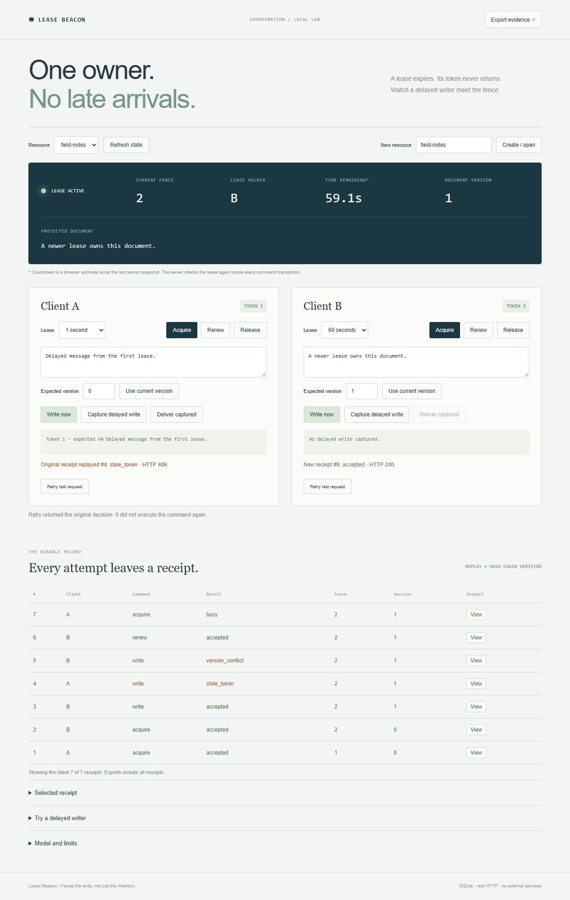

# Lease Beacon

A local coordination workbench with expiring leases, monotonically increasing fencing tokens, versioned document writes, and durable command receipts. Two client panels make delayed requests and stale ownership visible.



## Run

Python 3.10+; Node 22+ only for JavaScript syntax checks. No runtime packages or external services.

```sh
python run.py --port 8000
```

Open http://127.0.0.1:8000 and create a resource. State persists in the ignored `data/leases.sqlite3`; use `--data PATH` for another workspace.

Try the failure scenario:

1. Client A acquires a 1-second lease and captures a delayed write.
2. After expiry, Client B acquires a lease and receives a higher fencing token.
3. B writes its document. Deliver A's captured request: the old token is rejected.
4. Retry A's request. Its original rejection is replayed without another execution or receipt.

Client tokens, expected versions, and captured requests are intentionally retained after expiry. Refresh reads authoritative state without renewing a lease or synchronizing a client's expected version. The countdown is a local estimate; command admission always uses the server transaction's time.

## Backend guarantees within this model

- `BEGIN IMMEDIATE` serializes lease checks, token issuance, version checks, protected writes, and receipt insertion. A new grant increments the fence even when the previous holder reacquires. Renewal preserves the fence and never shortens expiry. Release preserves the fence and document.
- Writes require the current token, matching holder label, an unexpired lease, and the current expected document version. Successful writes increment the version exactly once. Old tokens are rejected even when their version happens to match.
- Request keys are scoped to a resource and bind to the entire normalized command. Exact retries return the original receipt, including denials, without executing again. Changed payloads under the same key conflict. Replaying an old accepted acquisition does **not** create a fresh lease; inspect current resource state separately.
- Server epoch milliseconds are clamped to a persisted high-water mark. Reads also persist observed time, preventing a backward wall-clock change from reviving a lease already observed as expired. Clock rollback can delay time progress; forward jumps can expire leases early. This is not a substitute for distributed clock or consensus design.
- Immutable, hash-linked receipts include requests, timestamps, before/after states, and outcomes. Reads and commands replay and verify the chain against stored state. A failed transaction rolls back state, clock changes, and the new receipt together.

## API

`POST /api/resources` accepts `{id}`. Reopening an existing ID preserves its state. `GET /api/resources` lists IDs, and `GET /api/resources/{id}` returns current state, server time, and verified receipt history.

`POST /api/resources/{id}/commands` accepts these exact fields:

| Command | Fields in addition to `action`, `holder`, `request_key` |
| --- | --- |
| `acquire` | `ttl_ms` |
| `renew` | `token`, `ttl_ms` |
| `release` | `token` |
| `write` | `token`, `expected_version`, `value` |

Accepted command receipts return HTTP 200. Recorded denials return HTTP 409 with a receipt and reason: `busy`, `stale_token`, `wrong_holder`, `expired`, or `version_conflict`. Reused keys with different commands return 409 without a new receipt. Invalid input returns 400, absent resources 404, and database failures 503.

Resource, holder, and request IDs use 1–48 ASCII characters. TTL is 1–60 seconds. Documents contain up to 2 KiB of UTF-8 text, excluding NUL and unpaired surrogates. Limits are 100 resources, 1,000 receipts per resource, and 10,000 receipts per database. HTTP command bodies are limited to 16 KiB.

## Evidence and verification

Exports contain every receipt, the exact `canonical_payload` string, SHA-256 checksum, and current state. Verify each checksum over the UTF-8 canonical string, parse it and compare with `receipt`, then follow `previous_hash` from the initial 64 zeroes. Replaying accepted and rejected commands reproduces the current document and fence.

```sh
python -m unittest discover -s tests -v
npm run check
```

Eleven tests cover exact expiry boundaries, delayed writes, 20 competing lease acquisitions, 20 duplicate requests, 16 competing versioned writes, old-denial replay, renewal/release, persisted clock rollback handling, injected transaction failures, immutable receipts, state corruption, input validation, and actual HTTP behavior. CI runs Python 3.11/3.13 on Ubuntu and Windows.

Browser checks exercised takeover, delayed delivery, denied retries, renewal, competing acquisition, and stale document versions. A separate Python verifier checked all seven exported example transitions, canonical bytes against SQLite, hash links, and the final token-2/version-1 document.

## Scope

The lease authority and protected document share one SQLite transaction boundary. This demonstrates fencing and optimistic concurrency; it is not a replicated or fault-tolerant distributed lock implementation. Holder names are labels, not authentication. A caller with access can claim any label or current token, and a database owner can rewrite history. Keep the server on loopback and use fictional text. No secrets, production access controls, automatic cleanup, clock synchronization, or cross-database atomicity are provided. Client-panel state is transient; durable server state survives reloads and restarts.

Background: [Martin Kleppmann, How to do distributed locking](https://martin.kleppmann.com/2016/02/08/how-to-do-distributed-locking.html).
